<div align="center">


# Dipper

<p><strong>A lightweight SQL workspace for developers.</strong></p>

<p>
PostgreSQL · MySQL · SQLite · Local-first · SQL notebooks
</p>

<p>
<a href="#install">Install</a> ·
<a href="#features">Features</a> ·
<a href="apps/server/README.md">API</a> ·
<a href="CONTRIBUTING.md">Contributing</a>
</p>


</div>

<br>

<p align="center">
  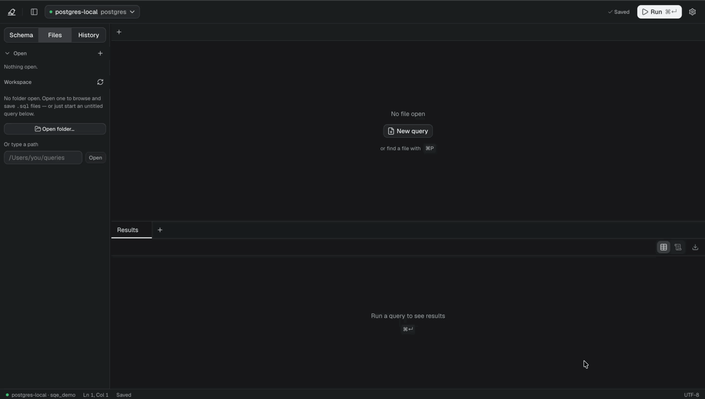
</p>

## What is Dipper?

Dipper is a lightweight SQL workspace for developers who spend their time **writing, exploring, and understanding SQL**.

It brings schema exploration, SQL editing, query execution, results, and database visualization into one focused workspace.

Dipper works with PostgreSQL and MySQL - running on your machine, in a container, or hosted somewhere like Neon, Supabase, or RDS - and with SQLite files on disk. Your SQL files stay on disk as normal `.sql` files, while Dipper provides the tools around them.

**No account. No cloud service. No bundled database.**

Dipper ships as a single self-contained binary - around 14 MB, with no runtime to install
alongside it.

## Features

### Schema-aware SQL editor

Write SQL with your database schema directly in context.

The schema sidebar shows tables, views, materialized views, columns, types, nullability, primary keys, and row estimates. The editor uses the same metadata for dialect-aware syntax highlighting and for completion.

Database errors are mapped back to the exact location in your query.

<p align="center">
  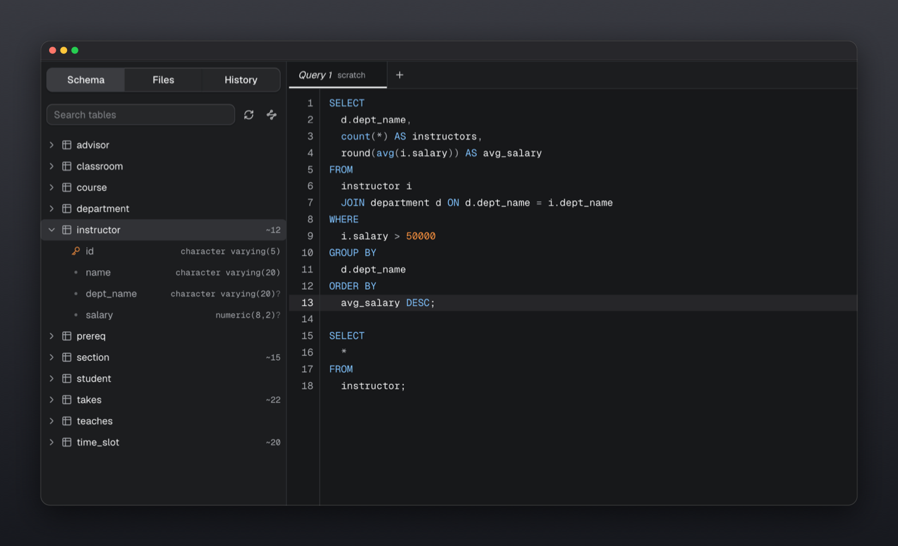
</p>

Run the statement under your cursor with <kbd>⌘</kbd><kbd>↵</kbd>, or the entire file with <kbd>⌘</kbd><kbd>⇧</kbd><kbd>↵</kbd>.

---

### Completion that reads your query

Dipper suggests what can actually go where your cursor is, not everything in the database.

Inside a `SELECT` it offers the columns of the tables you have joined so far - not every column in every table. Where a table can go, it offers tables, and after `JOIN` the ones related to what is already in the statement come first. Type `ON` and the join condition is offered already written, straight from the foreign key. Keywords are only suggested where they are legal, and rank below your own tables and columns, because the keyword you want is usually one you can already spell.

It works on half-written SQL, which is the only kind that needs it.

<p align="center">
  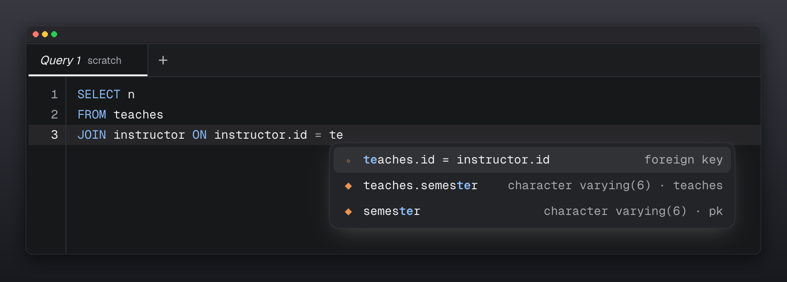
</p>

---

### Relationship View

**See how your database fits together.**

Relationship View turns foreign-key relationships into an interactive schema diagram. Tables show their columns and keys, while relationships are drawn between the tables they connect.

Click to focus on a table, drag to rearrange the layout, and zoom or pan around larger schemas.

<p align="center">
  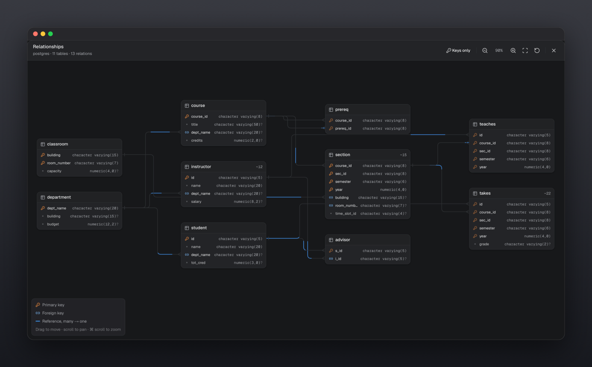
</p>

Large tables automatically switch to a compact keys-only view, keeping the diagram readable.

---

### Query Walk

**See how a SQL query produces its result.**

Query Walk visualizes a `SELECT` step by step through its major stages:

```text
FROM → JOIN → WHERE → GROUP BY → HAVING
→ WINDOW → SELECT → DISTINCT → ORDER BY → LIMIT
```

At each stage, Dipper shows the rows returned by your database and explains what happened.

This makes complex SQL easier to understand, debug, and explain - especially joins, filtering, aggregation, window functions, subqueries, `CASE`, and set operations.

<p align="center">
  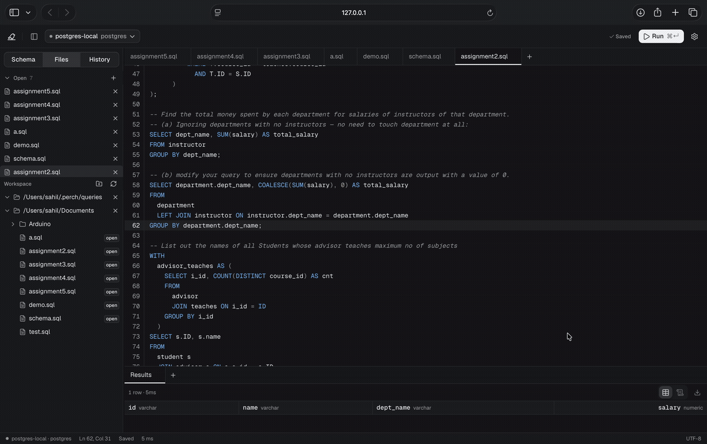
</p>

The visualization is based on your actual SQL and database. Query Walk uses read-only executions and does not modify your data.

**To open it:** put the cursor in a `SELECT` (or select the part you want), right-click and choose **Visualise query**, or open the command palette (<kbd>⌘</kbd><kbd>K</kbd>, or <kbd>Ctrl</kbd>+<kbd>K</kbd>) and run **Visualise query**. It plays automatically: pause it with the controls at the top right, then use the left and right arrow keys to step through the stages.

---

### Pin a result and compare

**Pin** on the results toolbar holds a result aside. Change the data or the query, run again, and
**Compare with pinned** lists rows added, rows removed and the exact cells that changed.

---

### Snippets

Command palette, **Snippets**: save SQL you reuse, tag it, and give it a trigger word. Type the
trigger in the editor and accept the completion to insert it; `${1:name}` marks the places Tab
moves between. **Save query as snippet** keeps what is in the editor.

---

### Files and search

The Files panel lists the `.sql` files of your workspace folders. Right-click a file to **rename**
or **delete** it. The search button finds text in file names and inside files, case-insensitively;
click a result to open the file at that line.

---

### Table Editor

**Browse and edit a table without writing SQL, then see exactly what will run.**

Double-click a table in the schema tree. Rows load a page at a time, sorted and filtered by the
database. Double-click a cell to edit it, add a row, or mark one for deletion. Nothing is written
yet: **Review and apply** lists every change as the SQL it will run, checks it against the
database with a dry run, and then applies all of it in one transaction, or none of it.

- Each edit carries the values you last saw, so a row changed by someone else is refused instead of overwritten
- NULL and DEFAULT are real choices, not typed words
- **Undo last change** appears after applying; it is reviewed like any change, and refused if a row changed again meanwhile
- Generated columns are locked; tables without a primary key, and views, open read-only
- The **Structure** tab shows sizes, vacuum state, columns, indexes with scan counts, constraints and triggers
- **Edit structure** (Structure tab) renames, retypes and drops columns, changes nullability and defaults, and adds or drops indexes. The DDL is reviewed first; Postgres dry-runs it and applies it in one transaction, while MySQL, which cannot roll back DDL, says so
- The **DDL** tab shows the statements that would recreate the table

---

### Query plans

Right-click a statement and choose **Explain plan**.

The plan is drawn as a tree, each step weighted by its cost, with the planner's row estimates next
to the rows it really produced. Switch on **Analyze** to run the query for real timings; it always
runs inside a transaction that is rolled back, so an `UPDATE` leaves nothing behind.

Dipper points out what is worth a look: stale statistics, large sequential scans, filters that
throw away most of what they read, and sorts that spilled to disk.

---

### SQL notebooks

Turn any `.sql` file into a notebook.

Each statement can run independently while keeping its own results, row count, and execution time.

```sql
-- Query 1
SELECT *
FROM orders
WHERE status = 'paid'
LIMIT 20;

-- %%

-- Query 2
SELECT *
FROM orders
WHERE status = 'paid'
  AND created_at > now() - interval '7 days';
```

The file remains valid SQL and can still be used outside Dipper.

<p align="center">
  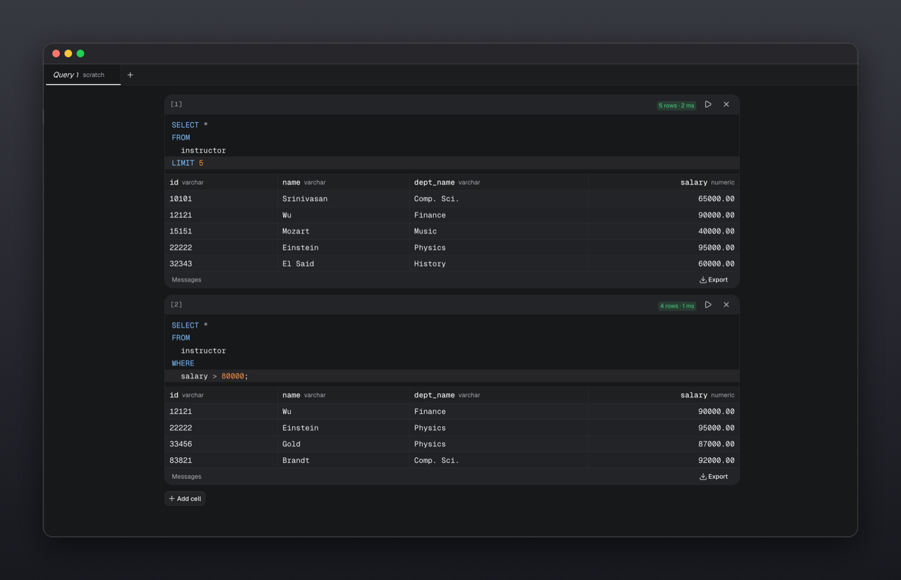
</p>

---

### Workspace folders

Open a directory and work directly with the `.sql` files inside it.

There is no import step or proprietary project format.

- Files open and save in place
- External changes are detected
- Multiple folders can be open
- Tabs and focus are restored between sessions
- Autosave is configurable
- Untitled queries can be saved into a workspace

<p align="center">
  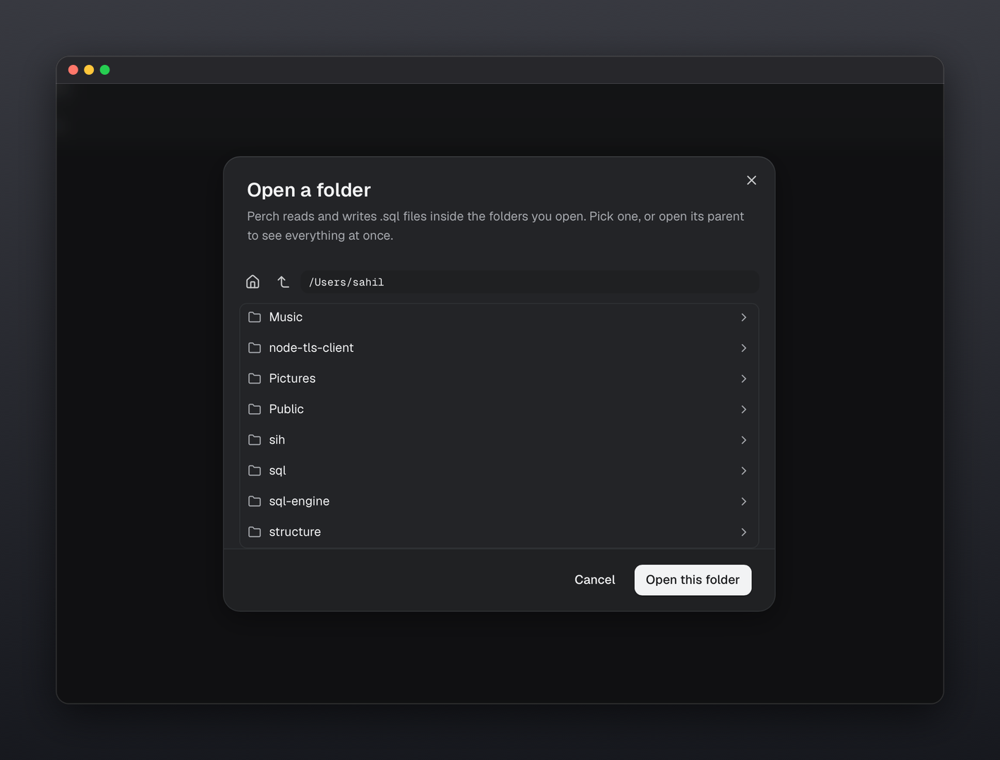
</p>

---

### Split panes

Compare queries and results side by side using a resizable pane layout.

Drag tabs to any edge to create splits, move tabs between panes, and restore the layout when you return.

<p align="center">
  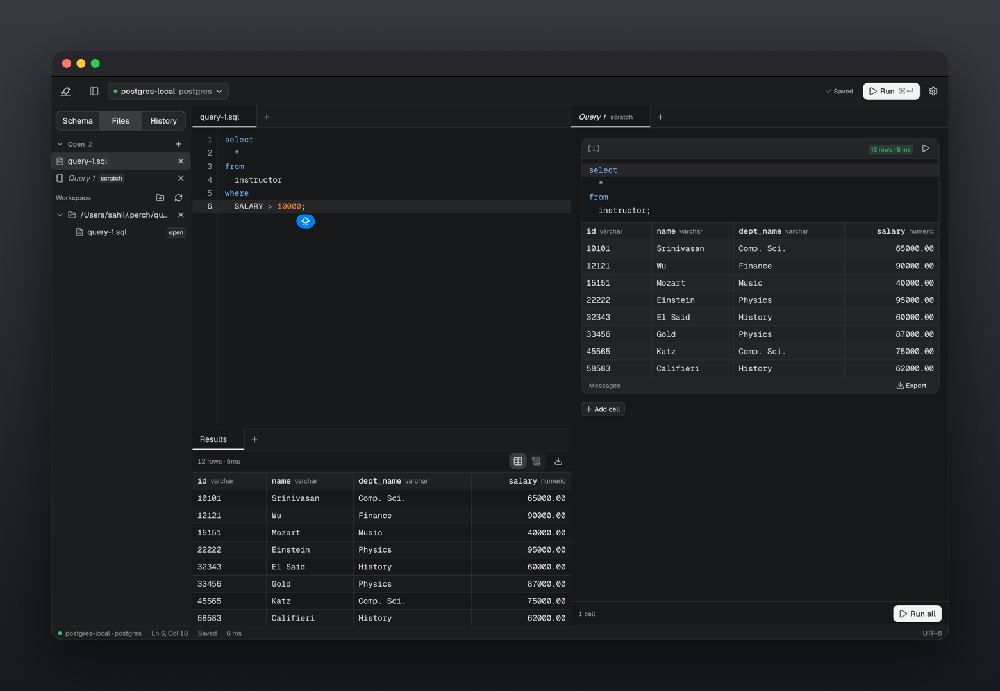
</p>

---

### Result grid

Inspect query results in a fast, virtualized grid.

- Typed column headers
- Row counts and execution time
- Distinct `NULL` representation
- Grid and text views
- CSV export
- Clipboard copying
- Separate result tabs for multi-statement queries
- Server messages and notices

<p align="center">
  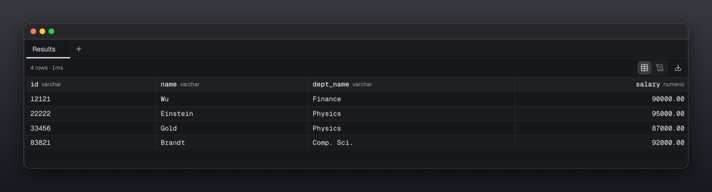
</p>

---

### Query history

Every query you run is kept, grouped by day, and survives restarts.

**History is split by folder.** The queries you ran while working in one project stay separate from the rest, and you can switch between the current folder, everything, and queries that were not run in a folder at all.

**You choose what is kept.** Settings → History saves nothing, just the queries you ran, or the queries and their results. Saving results is off by default - it puts a copy of what your database returned on disk, so it is yours to turn on. With it on, a query from last week reopens with the rows it returned, and exports again.

Opening a query from history shows the SQL above its results. Right-click any entry to run it again or copy it.

Old runs are dropped once you pass the limits you set, and **Clear history** empties the lot.

<p align="center">
  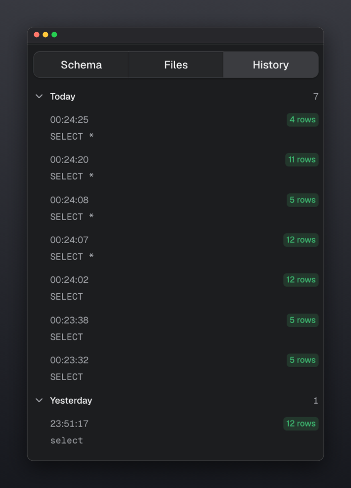
</p>

<p align="center">
  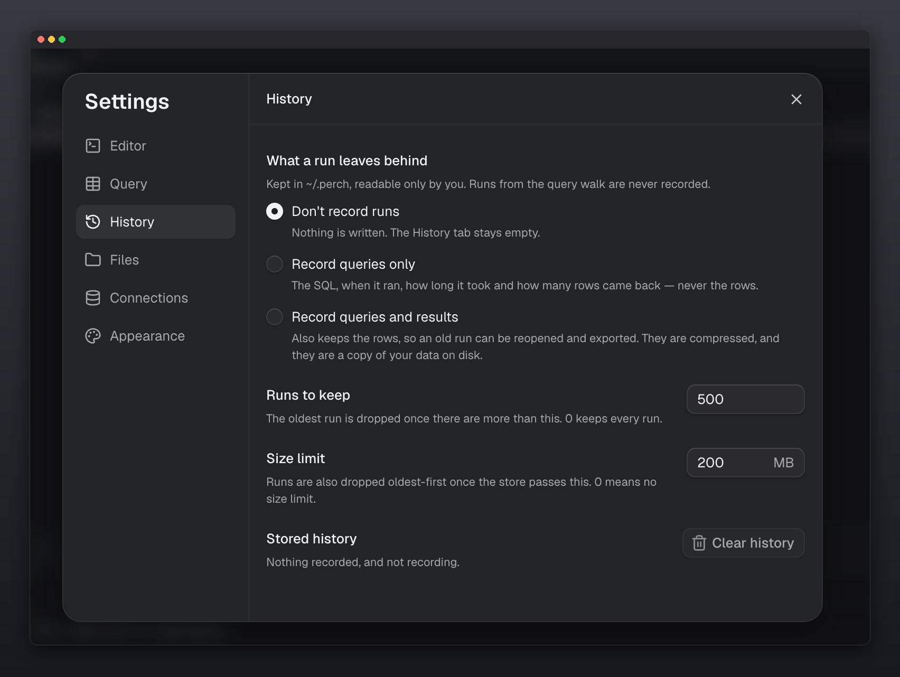
</p>

---

### Database tools

Everything below is in the command palette (<kbd>⌘</kbd><kbd>K</kbd>) and runs against your own server. Nothing changes until you have read it.

- **Activity** shows every session, what it is waiting for, how long its query and transaction have run, and who is blocking whom. Cancel a query or end a connection after a confirmation.
- **Health and index advice** finds unused, duplicate and invalid indexes, foreign keys with no supporting index, and tables with many dead rows. Each finding comes with the statement that would fix it, which Dipper never runs for you. PostgreSQL.
- **Slow queries** ranks the statements that have cost the most total time, the slowest on average, or the most called. It reads `pg_stat_statements` on PostgreSQL and the performance schema on MySQL, and tells you what to turn on when neither is.
- **Compare schemas** shows what would make the current database match another on the same connection (tables, columns, types, nullability, defaults and foreign keys) and writes the migration script, with anything that deletes data last and marked.
- **Database objects** lists functions and procedures with their full definitions, sequences, enum types, extensions and triggers.
- **SQL lint** in the plan view flags `= NULL`, `NOT IN` with a subquery, `UPDATE` or `DELETE` with no `WHERE`, accidental cross joins, leading-wildcard `LIKE` and a function wrapped around a column in `WHERE`.

<p align="center">
  <em>Mark a connection read-only in Settings and the server refuses every write through it, whatever the client asks. Give it a colour so production never looks like a test database.</em>
</p>

---

### SQLite

Choose SQLite when connecting and give it the path of a database file (or `sqlite:///path/to/app.db`).
There is no server and no password; the file is opened by Dipper itself, with no SQLite install
needed. Schema browsing, the Table Editor, table structure, query plans (`EXPLAIN QUERY PLAN`) and
read-only connections work as elsewhere. Health advice, the activity monitor, slow-query statistics and
transactions that span statements are PostgreSQL and MySQL only.

### Results

Find in the loaded rows, click a column header to sort (numbers sort as numbers, NULL stays last), and select a cell to read it in full with JSON indented and a Copy button. Export a result as CSV, TSV, JSON, NDJSON, Markdown, or SQL `INSERT` statements.

---

### Command palette

Press <kbd>⌘</kbd><kbd>K</kbd> to search Dipper without leaving the keyboard.

Search across:

- Commands
- Open files
- Connections
- Databases
- Tables

Switching connections or databases automatically updates the schema and editor context.

<p align="center">
  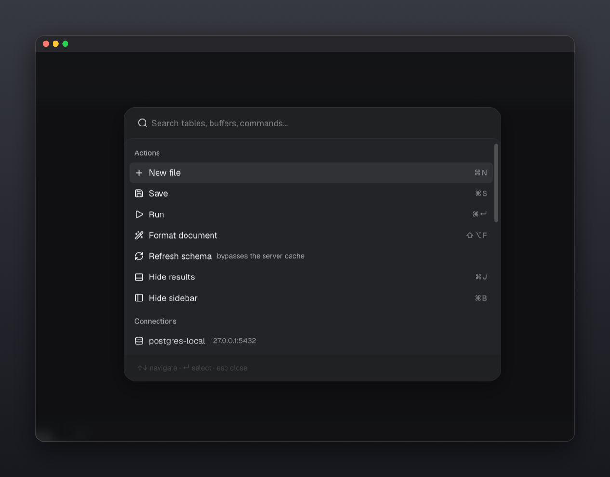
</p>

## Install

### macOS and Linux

```sh
curl -fsSL https://raw.githubusercontent.com/SumitKumar-17/dipper/main/install.sh | sh
```

This fetches the latest release for your platform, verifies its checksum, and installs `dipper`
into `/usr/local/bin` if that is writable, or `~/.local/bin` otherwise.

If it lands somewhere that is not on your `PATH`, the installer adds it to your shell profile
(`~/.zshrc`, `~/.bash_profile` or `~/.bashrc`, or fish's `config.fish`) and prints one line to
paste into the terminal you already have open. New terminals need nothing.

```sh
dipper          # starts the server and opens the UI
dipper status   # is it running, and where
dipper stop     # stop it
dipper update   # install the latest release over this one
```

| Variable                | What it does                                             |
| ----------------------- | -------------------------------------------------------- |
| `DIPPER_VERSION`         | install a specific tag, e.g. `vX.Y.Z`, instead of latest |
| `DIPPER_INSTALL_DIR`     | install somewhere else, e.g. `~/bin`                     |
| `DIPPER_NO_MODIFY_PATH`  | leave the shell profile alone and just print the line    |
| `DIPPER_NO_UPDATE_CHECK` | don't look for a newer release on start                  |

### Updating

```sh
dipper update           # download the latest release and replace this binary
dipper update --check   # just say whether there is a newer one
```

`update` fetches the release for your platform, verifies it against the release's checksum, and
replaces the binary in place - the same file `dipper` already runs from, wherever the installer
put it. Nothing else on disk is touched: connections, settings and history stay where they are.

A server that is already running keeps the old version until you restart it (`dipper stop`, then
`dipper`), and `dipper update` says so when it finds one.

`dipper serve` also looks for a newer release once a day, in the background, and prints a single
line when there is one. It never blocks startup and never updates anything on its own; set
`DIPPER_NO_UPDATE_CHECK=1` to turn the look off entirely.

`dipper update --version v0.1.0` installs that exact tag, which is how you go back a version.

On Windows, `dipper update` replaces the `.exe` you ran it from. Windows will not delete a file
that is open, so the previous version is left beside it as `dipper.exe.old` and cleared on the
next update - deleting it by hand is fine too.

### Windows

In PowerShell:

```powershell
irm https://raw.githubusercontent.com/SumitKumar-17/dipper/main/install.ps1 | iex
```

This downloads the latest release, verifies its checksum, installs `dipper.exe` into
`%LOCALAPPDATA%\Programs\dipper` and adds that folder to your user `PATH` (open a new terminal
afterwards). It reads the same `DIPPER_VERSION`, `DIPPER_INSTALL_DIR` and `DIPPER_NO_MODIFY_PATH`
variables as the shell installer. The script has not yet been run on a Windows machine, so if it
misbehaves, please open an issue.

Or download `dipper-<version>-windows-amd64.exe` from the
[releases page](https://github.com/SumitKumar-17/dipper/releases/latest) and run it. Windows shows a
SmartScreen warning the first time - choose **More info → Run anyway**.

### From source

Needs Go 1.25+ and Bun. See [`CONTRIBUTING.md`](CONTRIBUTING.md).

### If macOS refuses to open it

Dipper's binaries are not notarized yet. The `curl` install above avoids this entirely, because
macOS only quarantines files a *browser* downloaded. If you took the binary from the releases
page instead and macOS says the developer cannot be verified:

```sh
xattr -d com.apple.quarantine ./dipper
```

## Getting started

On first launch, choose a workspace, connection, and database.

Dipper finds the databases already on your machine - on their usual ports, installed through Homebrew or systemd, running as a Windows service, or in a Docker, Podman or nerdctl container - and offers to connect to each one. Containers are offered with the username they were set up with. If a database needs a password, Dipper asks for it there and then.

For a database somewhere else, paste the connection string your provider gave you - Neon, Supabase, RDS, or anything else. Connections that leave your machine use TLS and their certificate is checked; if your connection string sets `sslmode`, Dipper uses that instead.

Dipper never installs or bundles a database server.

## Keyboard shortcuts

| Shortcut                             | Action                    |
| ------------------------------------ | ------------------------- |
| <kbd>⌘</kbd><kbd>↵</kbd>             | Run selection / statement |
| <kbd>⌘</kbd><kbd>⇧</kbd><kbd>↵</kbd> | Run entire file           |
| <kbd>⌘</kbd><kbd>K</kbd>             | Command palette           |
| <kbd>⌘</kbd><kbd>⌥</kbd><kbd>N</kbd> | New query                 |
| <kbd>⌘</kbd><kbd>B</kbd>             | Toggle sidebar            |
| <kbd>⌘</kbd><kbd>J</kbd>             | Toggle results            |
| <kbd>⌘</kbd><kbd>S</kbd>             | Save                      |
| <kbd>⌘</kbd><kbd>&#92;</kbd>         | Split pane                |
| <kbd>⌘</kbd><kbd>,</kbd>             | Settings                  |
| <kbd>⇧</kbd><kbd>⌥</kbd><kbd>F</kbd> | Format SQL                |

Use <kbd>Ctrl</kbd> instead of <kbd>⌘</kbd> and <kbd>Alt</kbd> instead of <kbd>⌥</kbd> on Windows and Linux. Inside the app every shortcut is labelled for your platform.

## Local-first

Dipper runs locally and keeps your workspace on your machine.

```text
~/.dipper/
├── connections.json
├── settings.json
├── history.db
├── server.json
├── update.json
└── queries/
```

`DIPPER_HOME` can be used to relocate this directory.

Dipper sends no telemetry and does not require a remote service for normal operation.

## Contributing

Dipper is a Bun workspace monorepo. The server and CLI are Go; the UI and the shared packages are
TypeScript.

See [`CONTRIBUTING.md`](CONTRIBUTING.md) for development setup, project structure, scripts, and verification.

Bug reports and feature requests: [GitHub Issues](https://github.com/SumitKumar-17/dipper/issues).

## License

MIT © [Sumit Kumar](https://github.com/SumitKumar-17)
