# Features

Everything Dipper does, one section each. The [README](../README.md) has the short version, and
[install.md](install.md) covers installing and updating.

## Schema-aware SQL editor

Write SQL with your database schema directly in context.

The schema sidebar shows tables, views, materialized views, columns, types, nullability, primary keys, and row estimates. The editor uses the same metadata for dialect-aware syntax highlighting and for completion.

Database errors are mapped back to the exact location in your query.

<p align="center">
  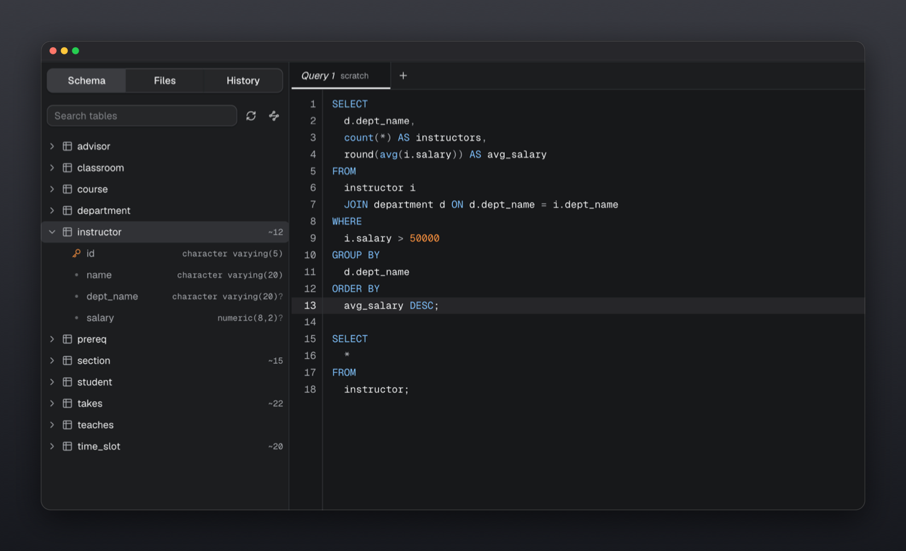
</p>

Run the statement under your cursor with <kbd>⌘</kbd><kbd>↵</kbd>, or the entire file with <kbd>⌘</kbd><kbd>⇧</kbd><kbd>↵</kbd>.

## Completion that reads your query

Dipper suggests what can actually go where your cursor is, not everything in the database.

Inside a `SELECT` it offers the columns of the tables you have joined so far - not every column in every table. Where a table can go, it offers tables, and after `JOIN` the ones related to what is already in the statement come first. Type `ON` and the join condition is offered already written, straight from the foreign key. Keywords are only suggested where they are legal, and rank below your own tables and columns, because the keyword you want is usually one you can already spell.

It works on half-written SQL, which is the only kind that needs it.

<p align="center">
  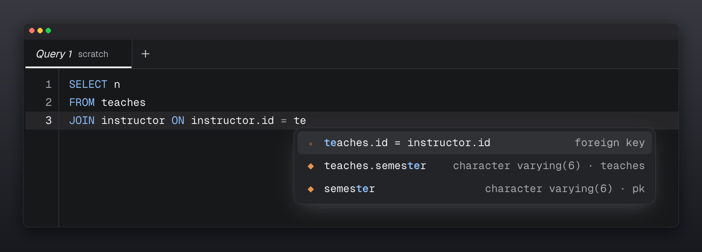
</p>

## Relationship View

**See how your database fits together.**

Relationship View turns foreign-key relationships into an interactive schema diagram. Tables show their columns and keys, while relationships are drawn between the tables they connect.

Click to focus on a table, drag to rearrange the layout, and zoom or pan around larger schemas.

<p align="center">
  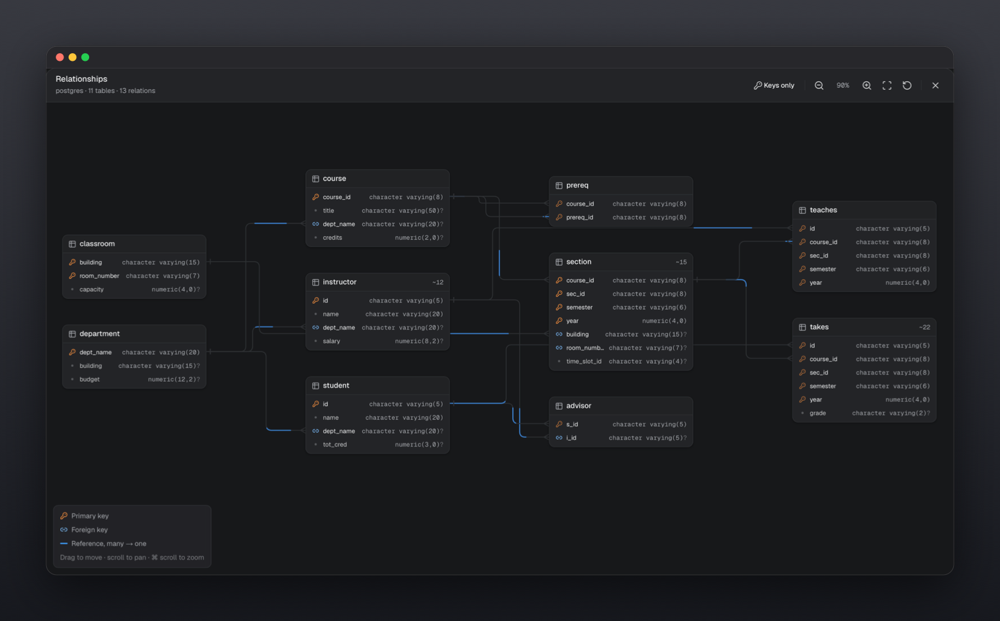
</p>

Large tables automatically switch to a compact keys-only view, keeping the diagram readable.

## Query Walk

**See how a SQL query produces its result.**

Query Walk visualizes a `SELECT` step by step through its major stages:

```text
FROM → JOIN → WHERE → GROUP BY → HAVING
→ WINDOW → SELECT → DISTINCT → ORDER BY → LIMIT
```

At each stage, Dipper shows the rows returned by your database and explains what happened.

Every window function gets a WINDOW stage of its own, which gathers the rows into the panes `PARTITION BY` cuts and then slides the function's frame down each pane as a band, so you can see exactly which rows each value was computed from.

A query with CTEs is walked one chapter per CTE, and a small graph above the stages shows which CTE feeds which and how many chapters use each one.

A `LATERAL` join is walked as what it is: the subquery runs once for every row before it, and each row is paired only with the rows its own run returned.

A recursive CTE is stepped one pass at a time, up to six passes: each stage shows exactly the rows that pass added, until a pass adds nothing and the recursion stops.

The **Plan** tab beside the walk shows the database's estimated plan for the query and lights the plan steps that do the work of the stage you are on, wherever the planner put them (Postgres).

This makes complex SQL easier to understand, debug, and explain - especially joins, filtering, aggregation, window functions, subqueries, `CASE`, and set operations.

<p align="center">
  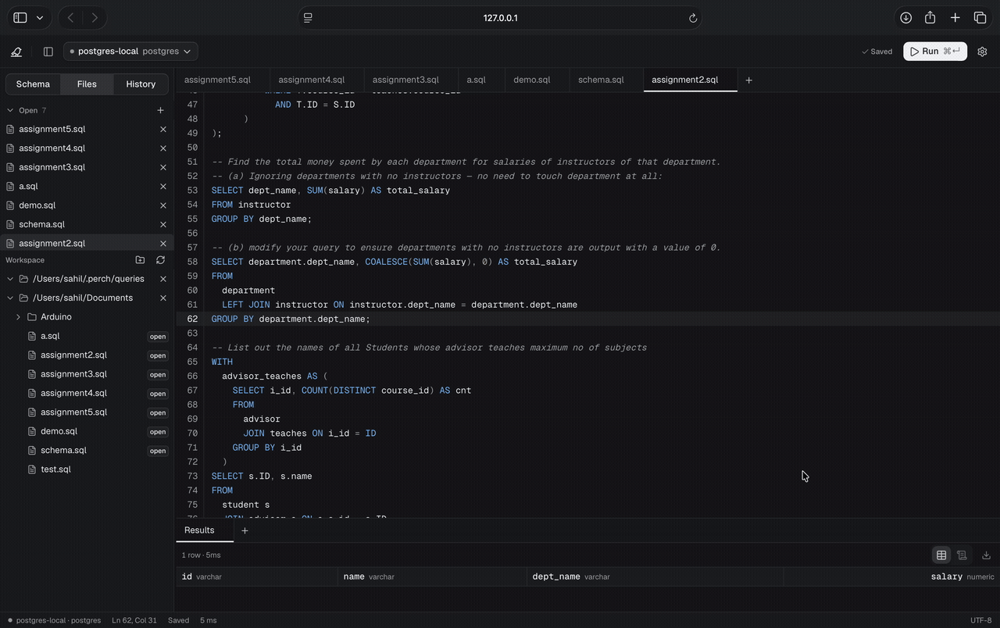
</p>

The visualization is based on your actual SQL and database. Query Walk uses read-only executions for a `SELECT`, and runs a write inside a transaction it always rolls back, so it does not modify your data.

Every stage of one walk reads the same data. The walk pins one connection and opens a read-only `REPEATABLE READ` transaction on it (a consistent snapshot on MySQL), so rows someone changes while the walk runs cannot make one stage disagree with another. A badge next to the title says which kind of walk you are looking at:

- **One snapshot** - every stage read the same snapshot, which is closed when the walk closes.
- **Your transaction** - you have a transaction open, so the walk reads inside it, sees your uncommitted changes, and leaves it exactly as it was.
- **Not snapshotted** - on SQLite (each stage reads the file on its own), while your own transaction has failed, or when the snapshot could not be opened; hover the badge for the reason.

**Export** (next to the playback controls) saves the walk as one standalone `.html` file that replays it anywhere: every stage, its narration and its rows, with play, pause and the arrow keys to step. It needs no network and loads nothing from outside itself, so it opens straight from disk, offline. It is a snapshot of the rows at export time, and says so; chapters that run once per row of another are named in it but not replayed.

### Walking an INSERT, UPDATE or DELETE

Visualise an `INSERT`, `UPDATE` or `DELETE` and the walk runs it for real, inside a transaction it **always rolls back**: also when the statement fails, and also when you close the walk while it is still running. Its stops show:

- **WHERE** - the rows the `WHERE` matched, as they were before anything changed (an `UPDATE` or `DELETE` with no `WHERE` says it touches every row).
- **Before and after** - every changed row with each changed cell before and after, paired on the table's primary key; rows inserted or deleted are listed as added or removed. A table without a primary key is paired on whole rows, so a changed row shows as one removed and one added.
- **RETURNING** - what your `RETURNING` handed back, when you wrote one.
- **Rolled back** - the rollback, confirmed by the server.

A rollback undoes everything the statement did inside the database, but not what it set in motion outside it: a sequence it drew from (a serial or identity column) stays advanced, and a trigger or function that wrote a file or called out over the network did that for real. (A `NOTIFY` is only sent on commit, so it is dropped.)

Write walks run on Postgres. Anything the walk cannot run safely is refused by name instead: several statements at once, DDL (`CREATE`, `ALTER`, `DROP`, `TRUNCATE`, ...), `MERGE`, `COPY`, `CALL`, `DO`, transaction control, `UPDATE ... FROM`, `DELETE ... USING`, `INSERT ... ON CONFLICT DO UPDATE`, `WHERE CURRENT OF`, a `WITH` in front of the write, and writes on MySQL (no `RETURNING` to read the change back) or SQLite (no session to hold the transaction).

**To open it:** put the cursor in a `SELECT` (or select the part you want), right-click and choose **Visualise query**, or open the command palette (<kbd>⌘</kbd><kbd>K</kbd>, or <kbd>Ctrl</kbd>+<kbd>K</kbd>) and run **Visualise query**. It plays automatically: pause it with the controls at the top right, then use the left and right arrow keys to step through the stages.

## Pin a result and compare

**Pin** on the results toolbar holds a result aside. Change the data or the query, run again, and
**Compare with pinned** lists rows added, rows removed and the exact cells that changed.

## Snippets

Command palette, **Snippets**: save SQL you reuse, tag it, and give it a trigger word. Type the
trigger in the editor and accept the completion to insert it; `${1:name}` marks the places Tab
moves between. **Save query as snippet** keeps what is in the editor.

## Files and search

The Files panel lists the `.sql` files of your workspace folders. Right-click a file to **rename**
or **delete** it. The search button finds text in file names and inside files, case-insensitively;
click a result to open the file at that line.

## Table Editor

**Browse and edit a table without writing SQL, then see exactly what will run.**

Double-click a table in the schema tree. Rows load a page at a time, sorted and filtered by the
database. Double-click a cell to edit it, add a row, or mark one for deletion. Nothing is written
yet: **Review and apply** lists every change as the SQL it will run, checks it against the
database with a dry run, and then applies all of it in one transaction, or none of it.

- **Export** downloads the table, filtered and sorted as you see it, as CSV, TSV, JSON, JSON lines, SQL INSERTs or Markdown (up to 100,000 rows)
- Each edit carries the values you last saw, so a row changed by someone else is refused instead of overwritten
- NULL and DEFAULT are real choices, not typed words
- **Undo last change** appears after applying; it is reviewed like any change, and refused if a row changed again meanwhile
- Generated columns are locked; tables without a primary key, and views, open read-only
- The **Structure** tab shows sizes, vacuum state, columns, indexes with scan counts, constraints and triggers
- **Edit structure** (Structure tab) renames, retypes and drops columns, changes nullability and defaults, and adds or drops indexes. The DDL is reviewed first; Postgres dry-runs it and applies it in one transaction, while MySQL, which cannot roll back DDL, says so
- The **DDL** tab shows the statements that would recreate the table

## Query plans

Right-click a statement and choose **Explain plan**.

The plan is drawn as a tree, each step weighted by its cost, with the planner's row estimates next
to the rows it really produced. Switch on **Analyze** to run the query for real timings; it always
runs inside a transaction that is rolled back, so an `UPDATE` leaves nothing behind.

Dipper points out what is worth a look: stale statistics, large sequential scans, filters that
throw away most of what they read, and sorts that spilled to disk.

## SQL notebooks

Turn any `.sql` file into a notebook.

Each statement can run independently while keeping its own results, row count, and execution time.

```sql
-- Query 1
SELECT *
FROM orders
WHERE status = 'paid'
LIMIT 20;

-- %%

-- Query 2
SELECT *
FROM orders
WHERE status = 'paid'
  AND created_at > now() - interval '7 days';
```

The file remains valid SQL and can still be used outside Dipper.

<p align="center">
  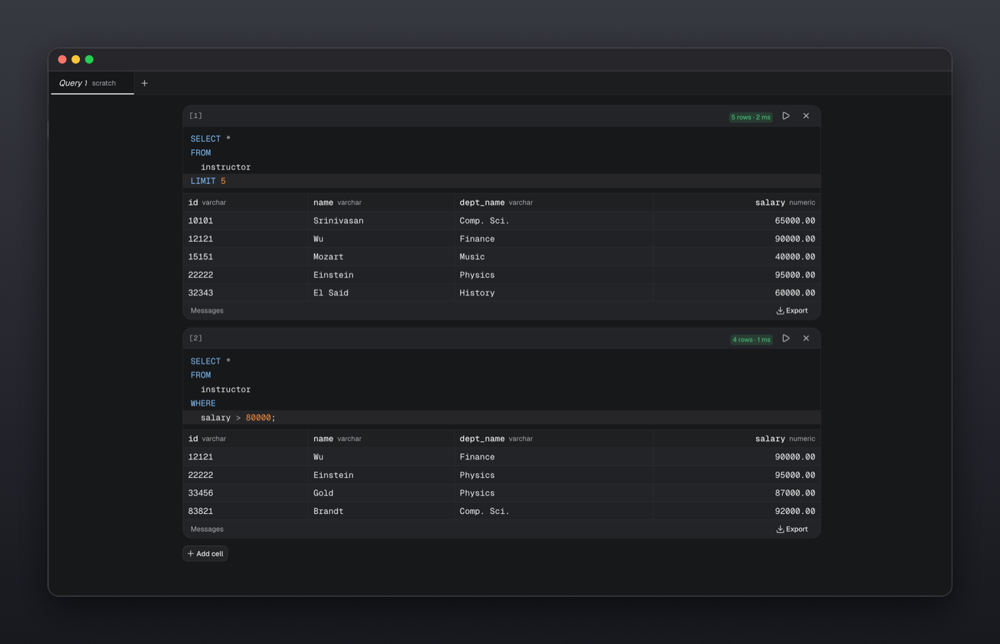
</p>

## One tab, one connection

Every query tab remembers the connection and database it runs on, so you can keep a test, a staging
and a production query open side by side and move between them by clicking a tab. The schema, the
results and the transaction controls all follow the tab you are on. A tab shows its connection's
colour tag, and its name once more than one connection is open.

Mark a connection red in Settings and running SQL that changes data or structure on it asks first,
showing the statement and the connection's name. Reads never ask.

Choose a connection in the picker and the tab you are on is pointed at it; a new tab starts on the
connection that is active. Tabs for files remember their connection across reloads. If the
connection a tab is set to cannot be reached, Run refuses with a message instead of running the
statement on a different database.

## Compare across connections

Command palette, **Compare across connections**: tick two or more connections, and Dipper runs the
statement under your cursor on each of them at the same time. You see each connection's rows and time,
and how its answer differs from the first one's: rows added, rows removed, and the exact cells that
changed, matched on the columns you pick. It answers "do staging and production agree" in one step.
Only statements that read can be compared, and at most 5,000 rows are read from each connection.

## Workspace folders

Open a directory and work directly with the `.sql` files inside it.

There is no import step or proprietary project format.

- Files open and save in place
- External changes are detected
- Multiple folders can be open
- Tabs and focus are restored between sessions
- Autosave is configurable
- Untitled queries can be saved into a workspace

<p align="center">
  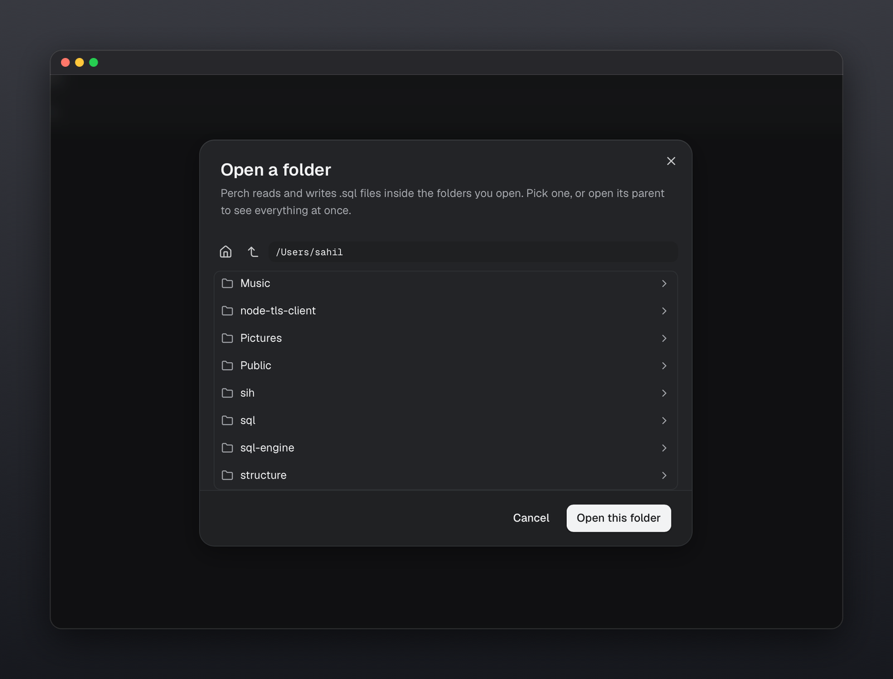
</p>

## Split panes

Compare queries and results side by side using a resizable pane layout.

Drag tabs to any edge to create splits, move tabs between panes, and restore the layout when you return.

<p align="center">
  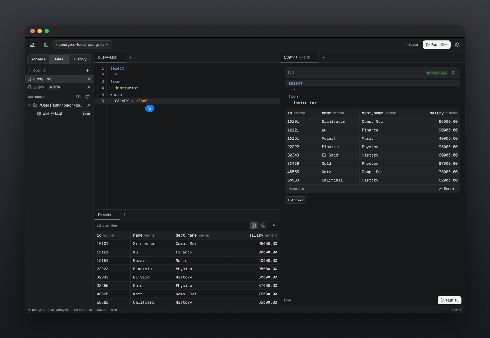
</p>

## Result grid

The expand button (the small corners icon) on the results toolbar and on each notebook cell opens the rows on their own, full size.

Inspect query results in a fast, virtualized grid.

- Typed column headers
- Row counts and execution time
- Distinct `NULL` representation
- Grid and text views
- CSV export
- Clipboard copying
- Separate result tabs for multi-statement queries
- Server messages and notices

<p align="center">
  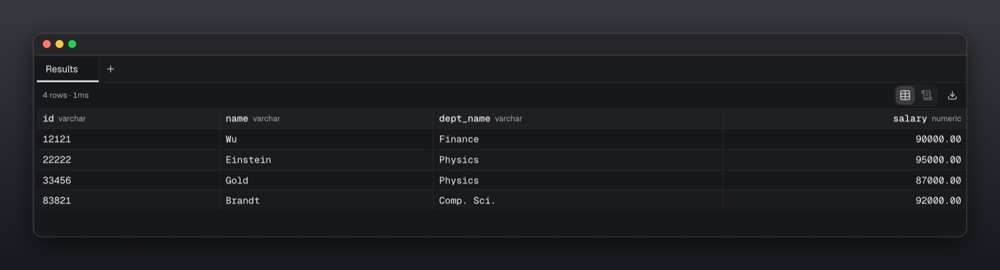
</p>

## Query history

Every query you run is kept, grouped by day, and survives restarts.

**History is split by folder.** The queries you ran while working in one project stay separate from the rest, and you can switch between the current folder, everything, and queries that were not run in a folder at all.

**You choose what is kept.** Settings → History saves nothing, just the queries you ran, or the queries and their results. Saving results is off by default - it puts a copy of what your database returned on disk, so it is yours to turn on. With it on, a query from last week reopens with the rows it returned, and exports again.

Opening a query from history shows the SQL above its results. Right-click any entry to run it again or copy it.

Old runs are dropped once you pass the limits you set, and **Clear history** empties the lot.

<p align="center">
  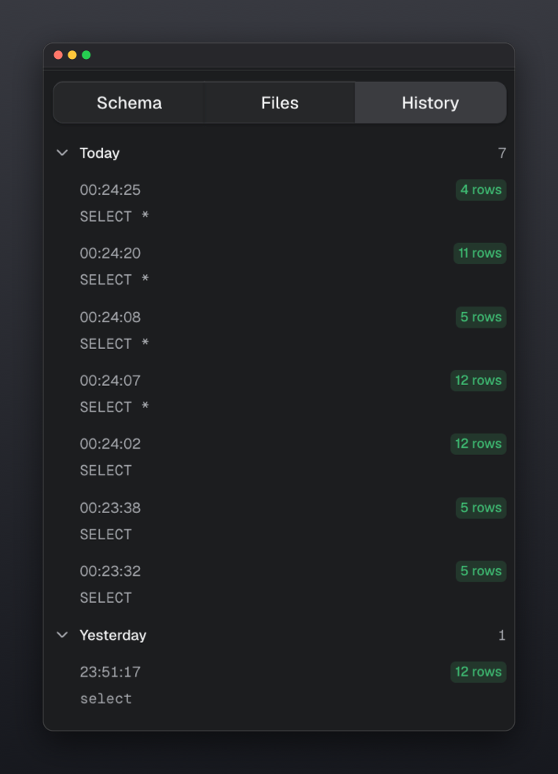
</p>

<p align="center">
  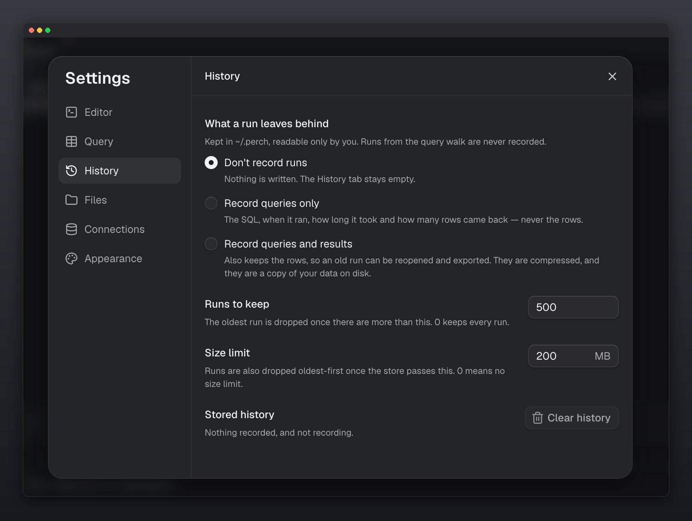
</p>

## Database tools

Everything below is in the command palette (<kbd>⌘</kbd><kbd>K</kbd>) and runs against your own server. Nothing changes until you have read it.

- **Activity** shows every session, what it is waiting for, how long its query and transaction have run, and who is blocking whom. Cancel a query or end a connection after a confirmation.
- **Health and index advice** finds unused, duplicate and invalid indexes, foreign keys with no supporting index, and tables with many dead rows. Each finding comes with the statement that would fix it, which Dipper never runs for you. PostgreSQL.
- **Slow queries** ranks the statements that have cost the most total time, the slowest on average, or the most called. It reads `pg_stat_statements` on PostgreSQL and the performance schema on MySQL, and tells you what to turn on when neither is.
- **Compare schemas** shows what would make the current database match another on the same connection (tables, columns, types, nullability, defaults and foreign keys) and writes the migration script, with anything that deletes data last and marked.
- **Database objects** lists functions and procedures with their full definitions, sequences, enum types, extensions and triggers.
- **SQL lint** in the plan view flags `= NULL`, `NOT IN` with a subquery, `UPDATE` or `DELETE` with no `WHERE`, accidental cross joins, leading-wildcard `LIKE` and a function wrapped around a column in `WHERE`.

<p align="center">
  <em>Mark a connection read-only in Settings and the server refuses every write through it, whatever the client asks. Give it a colour so production never looks like a test database.</em>
</p>

## Connecting

Paste a connection into any field of the connection form and the form fills itself in: the host,
port, user, database, password, TLS and the advanced options it has fields for. It reads

- a URL: `postgres://`, `postgresql://`, `mysql://`, `mariadb://`, including SQLAlchemy's
  `postgresql+psycopg2://` spelling, and `sqlite:///path/to/app.db` or a path to a `.db` file;
- a `psql` or `mysql` command line, with `-h`, `-p`/`-P`, `-U`/`-u`, `-d`, the long flags, a URL
  as the database argument, and a `PGPASSWORD=` or `MYSQL_PWD=` prefix;
- a `DATABASE_URL=...` or `export DATABASE_URL=...` line, or a whole `.env` block of `PGHOST`,
  `PGUSER` and friends;
- a JDBC string such as `jdbc:postgresql://host:5432/db?user=app&password=...`;
- a libpq keyword string such as `host=db port=5432 dbname=app user=app sslmode=require`.

Typing a host works too: `db.example.com:5433` splits into host and port when you leave the field,
and an empty user, database and name are filled from the dialect's defaults and the host. Neon,
Supabase (direct and pooler), Amazon RDS and Aurora, PlanetScale and Azure hosts turn TLS on and
show a short note about that provider.

Every filled field is marked, one Undo takes the whole fill back, and nothing you typed (or a saved
connection's own values) is ever replaced: those are listed as kept instead. A pasted password goes
only into the password field. Text that is not a connection, or a connection that looks malformed,
pastes as ordinary text. Parameters the form has no field for are named, so nothing is dropped
silently. In URL mode, a URL pasted into the URL field stays a URL, as before.

## SQLite

Choose SQLite when connecting and give it the path of a database file (or `sqlite:///path/to/app.db`).
There is no server and no password; the file is opened by Dipper itself, with no SQLite install
needed. Schema browsing, the Table Editor, table structure, query plans (`EXPLAIN QUERY PLAN`) and
read-only connections work as elsewhere. Health advice, the activity monitor, slow-query statistics and
transactions that span statements are PostgreSQL and MySQL only.

## Results

Find in the loaded rows, click a column header to sort (numbers sort as numbers, NULL stays last), and select a cell to read it in full with JSON indented and a Copy button. Export a result as CSV, TSV, JSON, NDJSON, Markdown, or SQL `INSERT` statements.

## Command palette

Press <kbd>⌘</kbd><kbd>K</kbd> to search Dipper without leaving the keyboard.

Search across:

- Commands
- Open files
- Connections
- Databases
- Tables

Start with a character to narrow it: `>` for commands only, `@` for tables (Enter opens the
table in the Table Editor), `#` for this session's past runs.

Switching connections or databases automatically updates the schema and editor context.

<p align="center">
  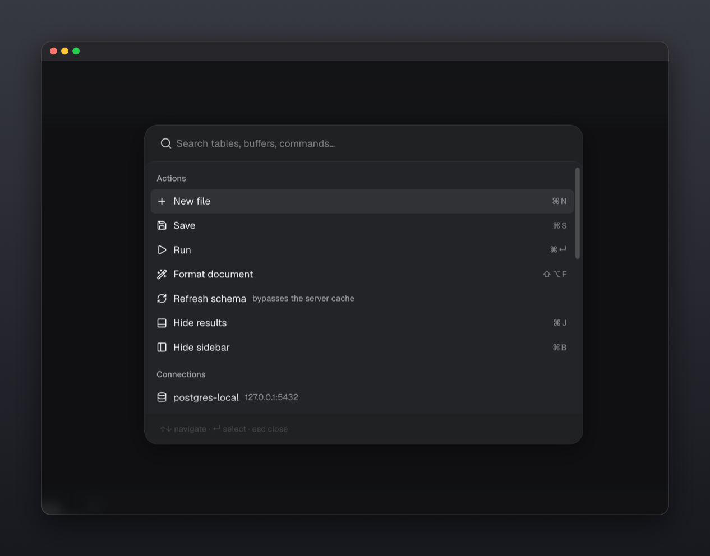
</p>

## Keyboard shortcuts

| Shortcut                             | Action                    |
| ------------------------------------ | ------------------------- |
| <kbd>⌘</kbd><kbd>↵</kbd>             | Run selection / statement |
| <kbd>⌘</kbd><kbd>⇧</kbd><kbd>↵</kbd> | Run entire file           |
| <kbd>⌘</kbd><kbd>K</kbd>             | Command palette           |
| <kbd>⌘</kbd><kbd>⌥</kbd><kbd>N</kbd> | New query                 |
| <kbd>⌘</kbd><kbd>B</kbd>             | Toggle sidebar            |
| <kbd>⌘</kbd><kbd>J</kbd>             | Toggle results            |
| <kbd>⌘</kbd><kbd>S</kbd>             | Save                      |
| <kbd>⌘</kbd><kbd>&#92;</kbd>         | Split pane                |
| <kbd>⌘</kbd><kbd>,</kbd>             | Settings                  |
| <kbd>⇧</kbd><kbd>⌥</kbd><kbd>F</kbd> | Format SQL                |

Use <kbd>Ctrl</kbd> instead of <kbd>⌘</kbd> and <kbd>Alt</kbd> instead of <kbd>⌥</kbd> on Windows and Linux. Inside the app every shortcut is labelled for your platform. Settings, **Shortcuts** lets you rebind any of them; a key that is already used or could not be typed around is refused with the reason, and your choices stay in this browser.
